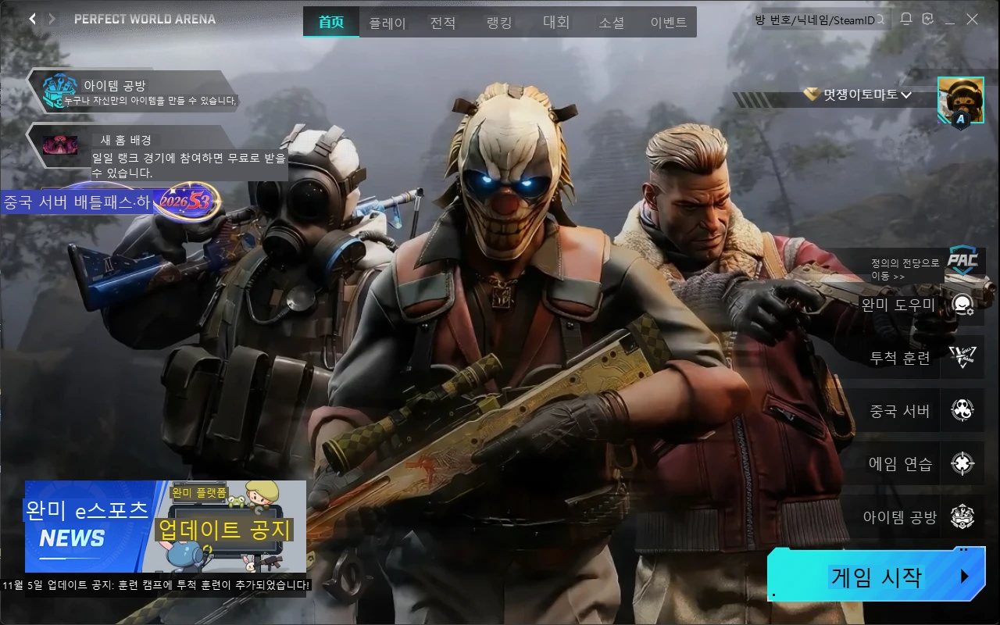

# 완미 한글 오버레이 (PWA Korean Overlay)

완미세계 경기 플랫폼(Perfect World Arena) 화면의 중국어를 **화면 캡처 + OCR**로 읽어서,
그 자리에 한국어를 덮어 그리는 오버레이입니다.

이전 한글패치는 `app.asar`를 수정하는 방식이었는데, 클라이언트 파일이 암호화되면서 더는 쓸 수 없게 됐습니다.
이 오버레이는 **클라이언트 파일, 메모리, 프로세스를 전혀 건드리지 않습니다.** 프로세스 핸들도 열지 않습니다(실행 파일 이름은 시스템 프로세스 목록에서 읽습니다).

> **비공식 도구입니다.** 완미세계(Perfect World)와 관련이 없습니다. 클라이언트 파일, 메모리, 프로세스를 건드리지 않고 화면 위에 그리기만 하지만, 안티치트나 약관상 문제가 없다고 보장하지는 않습니다. **사용에 따른 책임은 사용자에게 있습니다.**

## 예시 화면


완미 메인 화면에 한국어를 덮어 그린 모습입니다.

## 다운로드
[Releases](https://github.com/JaeHeong/PerfectWorldArena-KoreanPatch-Overlay/releases)에서 최신 zip을 받아 원하는 곳에 압축을 풀고 `PWAKoreanOverlay.exe`를 실행합니다. Windows 10(2004 이상) 또는 11, 64비트가 필요합니다. 처음 실행할 때 "Windows의 PC 보호" 경고가 뜨면 **추가 정보 → 실행**을 누르면 됩니다. 서명되지 않은 실행 파일이라 그렇습니다.

## 동작 방식
1. `完美世界竞技平台.exe` 프로세스의 창만 찾아서 위치를 따라갑니다. 이동, 크기 변경, 최소화에 반응합니다.
2. 완미 창이 **활성 창일 때만** 그 영역을 캡처합니다. 그 외에는 오버레이 창 자체를 숨깁니다.
3. 화면이 바뀌면 잠시 안정되기를 기다린 뒤 OCR(RapidOCR, PP-OCRv6)을 실행합니다.
   - **기본은 CPU small 모델입니다.** 메모리 약 0.5GB를 쓰고, 새 화면은 약 1.3초, 거의 그대로인 화면은 약 0.4초 걸립니다.
   - **트레이 메뉴의 "GPU 가속"을 켜면** GPU(DirectML)의 medium 모델을 씁니다. 약 0.45초로 빠르고 인식도 조금 더 정확하지만, **메모리를 약 2GB** 씁니다. DirectML 런타임 특성상 엔진을 해제해도 약 1GB가 남습니다. 이 설정은 `config.json`에 저장됩니다.
   - 모델 파일(약 140MB)은 처음 실행할 때 한 번 내려받습니다.
   - 바뀌지 않은 글자 박스는 인식 결과를 재사용합니다.
   - 애니메이션 영역은 학습해서 제외하고, 결과가 같으면 재OCR 간격을 최대 6초까지 늘립니다.
4. **사전 → 번역 캐시 → Claude** 순서로 번역합니다.
   - **사전:** `data/mappings/*.json`, `data/glossary.json`, `data/user_dict.json`에서 정확히 일치, `${var}` 템플릿, 유사도(OCR 오인식 보정) 순서로 찾습니다. 숫자나 부정어(不/未/无 등)가 다른 문장은 유사도로 매칭하지 않습니다.
   - **번역 캐시(`data/translation_cache.json`):** 예전에 Claude가 번역한 결과입니다. 재시작해도 남고, 숫자만 다른 문장(`5/20`과 `6/20`)과 OCR이 다르게 읽은 장식 기호(`·`, `:`, `>`)는 하나로 취급합니다.
   - **Claude:** 둘 다 없으면 한 화면의 새 문장을 모아 Claude(`claude-haiku-5-5`)에 **텍스트로만** 한 번에 보냅니다.
     - 화면 전체 문장을 읽는 순서대로 함께 보내 문맥을 줍니다.
     - 용어집(`data/glossary.json` + 사용자 사전)을 함께 보내 용어를 통일합니다.
     - 결과가 오면 OCR을 다시 하지 않고 바로 화면에 반영합니다.
   - **문장 단위:** 줄바꿈된 긴 문장은 한 문단으로 합쳐서 번역하고, 제목과 목록 항목은 각각 번역합니다.
   - **OCR이 자신 없는 글자 보정:** 확실한 글자만으로 사전 항목이 하나로 정해지면 API 없이 그 번역을 씁니다.
5. 원문 위치에 배경색과 글자색을 맞춰 한국어를 그립니다.
   - 글자가 배경과 잘 구분되지 않으면 흑백 중 대비가 큰 색으로 바꿉니다.
   - 그림 위 텍스트는 반투명한 판과 외곽선으로 그립니다.
   - 한국어가 길면 옆 글자와 겹치지 않는 범위에서 넓히고, 그래도 안 들어가면 줄이거나 두 줄로 나눕니다.
6. 원문 글자 픽셀이 바뀌면(숫자 하나라도) 해당 번역을 바로 지우고 다시 읽습니다. 글자 뒤 배경만 움직이는 경우는 무시합니다.

## Claude 번역 설정 (선택)
API 키가 없으면 사전만으로 동작합니다. 키를 설정하면 사전에 없는 문장도 번역합니다.

1. Max, Ultra, Team 요금제라면 claude.ai → 설정 → 청구 → **API 크레딧**에서 Console 조직을 연결합니다. 매달 주는 API 크레딧이 그 조직으로 들어옵니다.
2. 연결한 조직의 Console(platform.claude.com)에서 API 키를 발급합니다.
3. PowerShell에서 환경 변수로 등록합니다. 등록한 뒤에는 터미널과 앱을 새로 열어야 반영됩니다.
   ```powershell
   setx ANTHROPIC_API_KEY "sk-ant-..."
   ```
4. 실행하면 `logs/overlay.log`에 `machine translation: on`이 찍힙니다. 호출할 때마다 `Claude usage today: N calls … ~$x`가 기록됩니다.

- 화면 이미지는 보내지 않습니다. OCR 텍스트만 보냅니다.
- 닉네임처럼 번역하면 안 되는 줄은 "그대로 둠"으로 기억해서 다시 보내지 않습니다. 번역에 실패한 줄은 5분 → 1시간 → 24시간 간격으로만 다시 시도합니다. 이 기록은 재시작해도 남습니다.
- 호출 상한은 시간당 1000회, 하루 10000회입니다(`mt_max_calls_per_hour`, `mt_max_calls_per_day`). 넘으면 트레이 알림이 뜨고 사전과 캐시만 쓰다가, 한도가 풀리면 보고 있던 화면을 자동으로 다시 번역합니다.
- 키가 잘못됐거나 모델 이름이 틀렸거나 크레딧이 떨어지면, 트레이 툴팁에 원인을 표시하고 사전만으로 계속 동작합니다. 크레딧이 소진되면 요청이 거절될 뿐, 자동 충전을 켜지 않았다면 추가 요금은 나가지 않습니다.
- `config.json`에 `"machine_translation": false`를 넣으면 키가 있어도 사전만 씁니다.

## 실행 파일 (설치 없이 사용)
바탕화면의 **완미 한글 오버레이** 바로가기를 더블클릭하면 됩니다. 실행 파일은 `dist\PWAKoreanOverlay\PWAKoreanOverlay.exe`입니다.
- 이미 실행 중이면 다시 실행해도 하나만 뜹니다.
- 사전, 용어집, 번역 캐시, 로그는 실행 파일 옆 `data\`와 `logs\` 폴더에 있습니다. 트레이 메뉴의 "사용자 사전 열기" 등은 이 폴더의 파일을 엽니다.
- API 키는 Windows 사용자 환경 변수(`setx ANTHROPIC_API_KEY ...`)에서 자동으로 읽습니다.
- 다시 빌드하려면 `powershell -ExecutionPolicy Bypass -File packaging\build.ps1`을 실행합니다. 기본 매핑만 갱신되고, 사용자 사전, 용어집, 번역 캐시는 덮어쓰지 않습니다.
- 빌드가 정상인지 확인하려면 `PWAKoreanOverlay.exe --selftest 스크린샷.png`를 실행합니다. 결과는 `logs\overlay.log`에 남습니다.

## 개발용 실행
[uv](https://docs.astral.sh/uv/)가 필요합니다.

```
uv sync
run.bat                      # 트레이에 '한' 아이콘이 생깁니다
uv run python -m pwa_overlay --debug     # 콘솔 로그와 박스 테두리 표시
```

트레이 아이콘을 왼쪽 클릭하면 번역을 켜고 끕니다. 오른쪽 클릭 메뉴는 이렇습니다.
- **이 화면 다시 번역:** 지금 화면 문장의 캐시를 지우고 다시 번역합니다. 용어집을 고친 뒤 쓰면 좋습니다.
- **불확실한 번역 캐시 비우기:** OCR이 자신 없던 줄의 번역만 지웁니다.
- **번역 안 된 문장 보기:** 사전에 없어서 번역하지 못한 문장이 `logs/untranslated.txt`에 모입니다. 사전만 쓸 때 기록합니다.
- **사용자 사전 열기 / 용어집 열기 / 사전 다시 불러오기:** 고친 뒤 재시작 없이 반영합니다. JSON에 오타가 있으면 몇 번째 줄인지 알려 주고, 이전 사전을 계속 씁니다.

### 사용자 사전(`data/user_dict.json`)
- `"원문": "번역"` 형식입니다. 기본 사전, 용어집, 캐시보다 우선합니다.
- 숫자가 들어간 문장은 숫자 자리에 `{0}`, `{1}`을 씁니다. 예: `"已完成次数:{0}/{1}": "완료 횟수: {0}/{1}"`
- `"OCR 오인식"` 묶음에는 OCR이 매번 똑같이 잘못 읽는 글자를 바로잡는 별칭을 넣습니다(예: `"首巅": "홈"`). 이 항목은 용어집으로는 보내지 않습니다.
- `data/glossary.json`은 Claude에게 전달되는 게임 용어집 초안입니다. 원하는 표현으로 고치세요.

### 옵션
| 옵션 | 설명 |
|---|---|
| `--debug` | 번역 박스 테두리 표시, 자세한 로그 |
| `--dump DIR` | OCR할 때마다 번역을 입힌 프레임을 PNG로 저장 (계정 정보가 찍히니 공유 주의) |
| `--always` | 완미 창이 활성 창이 아니어도 표시 (테스트용, CS2가 앞에 있으면 그래도 멈춤) |
| `--target EXE`, `--title TEXT` | 대상 프로세스와 창 제목 지정 (테스트용) |

`config.json`(선택)으로 기본값을 바꿀 수 있습니다. 필드는 `src/pwa_overlay/config.py`를 참고하세요.

## 게임(CS2)에 주는 영향
CS2 프레임이나 입력 반응에 영향을 주지 않도록 이렇게 동작합니다.
- **CS2(`cs2.exe`)가 활성 창이면** 어떤 설정이든 캡처, OCR, 번역, 그리기를 모두 멈춥니다. 오버레이 창도 숨기고, OCR 엔진을 바로 내려 GPU 메모리를 반납합니다. 진행 중이던 OCR이 있으면 끝나는 즉시 반납합니다.
- **CS2가 뒤에서 실행 중이기만 해도**(워밍업 중 alt-tab, 최소화 등) GPU 모델을 올리지 않습니다. 대신 CPU small 모델을 스레드 2개로 씁니다(`allow_gpu_while_game_running`). 게임 중 잠깐 alt-tab한 정도로는 모델을 올리지 않게, 런처가 0.7초 이상 앞에 있어야 OCR을 시작합니다.
- **같은 화면으로 돌아오면** OCR을 다시 하지 않고 이전 번역을 그대로 보여 줍니다.
- **오버레이 창은 그릴 게 있을 때만 존재합니다.** 화면 전체가 아니라 완미 창 영역만 덮습니다.
- **쉬는 동안의 부담:** 0.5초마다 창 상태만 확인합니다. 다른 창으로 넘어간 경우 60초 뒤 OCR 엔진을 반납합니다(`idle_release_s`).
- **CPU 양보:** 프로세스 우선순위를 "낮음"으로 실행하고, OCR의 CPU 스레드는 4개로 제한합니다(`ocr_cpu_threads`).
- 기본 CPU 모드는 메모리를 약 0.5GB만 씁니다. GPU 가속은 메모리를 약 2GB 쓰므로 메모리가 넉넉한 PC에서만 켜세요.

실제 CS2에서 프레임을 측정하지는 않았습니다. 확인하고 싶으면 [PresentMon](https://github.com/GameTechDev/PresentMon)으로 cs2.exe의 Present Mode가 `Hardware: Independent Flip`인지 확인해 보세요.

## 한계
- 런처 창만 대상입니다. CS2 게임 안의 완미 화면은 지원하지 않습니다.
- 사전에 없는 문장은 API 키가 없으면 원문 그대로 둡니다.
- 화면이 바뀐 뒤 번역이 뜨기까지 OCR에 약 1.3초(CPU, 기본값) 또는 약 0.5초(GPU 가속) 걸립니다. 처음 보는 문장은 Claude 응답까지 2~4초가 더 걸립니다.
- 그림 위에 크게 쓰인 장식 제목은 배경을 깔끔하게 덮기 어렵습니다.
- 안티치트가 화면 캡처나 오버레이를 어떻게 판단할지는 보장할 수 없습니다.

## OCR 진단
"인식이 안 된다" 싶을 때 OCR이 못 읽는 건지, 사전에 없는 건지 확인합니다.
```
uv run python -m pwa_overlay.diagnose --image 스크린샷.png             # 사전만 기준, 설정별 비교
uv run python -m pwa_overlay.diagnose --image 스크린샷.png --preview   # 실제 앱과 같은 전체 번역 + 미리보기 그림
uv run python -m pwa_overlay.diagnose                                  # 완미 창을 클릭하면 그 화면을 캡처
```
`logs/diag/<시각>/`에 결과가 저장됩니다.
- 비교 모드: 초록 박스는 번역된 줄, 주황 박스는 읽었지만 사전에 없는 줄입니다.
- `--preview`: OCR이 자신 없던 줄을 따로 보여 줍니다. 계속 틀리는 줄은 사용자 사전의 `"OCR 오인식"`에 추가하세요.

## 개발
```
uv run pytest                                # 사전, 번역, OCR 파이프라인, 게임 보호 테스트
uv run python tests/fake_client.py           # 가짜 클라이언트 창
uv run python -m pwa_overlay --target python.exe --title PWA-FAKE-CLIENT --always --debug
```

## 번역 캐시와 공유
| 파일 | 내용 | git |
|---|---|---|
| `data/translation_cache.json` | 사용하면서 쌓이는 내 PC의 캐시 | 올리지 않음 |
| `data/translation_cache.shared.json` | 닉네임 등을 걸러 낸 공개용 캐시 | 올림 |

- 앱은 시작할 때 공유본을 내 캐시에 합칩니다. 내 쪽에 없는 번역은 추가하고, 양쪽에 다 있으면 더 최근 번역을 남깁니다. 그 뒤로는 내 캐시만 읽고 씁니다. 공유본은 앱이 수정하지 않습니다.
- 공유본을 갱신하려면 아래 명령을 실행합니다. 쌓인 내 캐시에서 "그대로 둠" 항목(대부분 다른 플레이어 닉네임)과 `data/cache_blocklist.txt`에 적은 문장(상태 메시지, 채팅 등)을 빼고 공유본을 다시 만듭니다. `git diff`로 확인한 뒤 커밋하세요.
  ```
  uv run python packaging/publish_cache.py
  ```
- 친구에게 따로 줄 때는 트레이의 **"번역 캐시 내보내기"**를, 받은 쪽은 **"번역 캐시 가져오기"**를 쓰면 됩니다. 내보내기에도 "그대로 둠" 항목은 들어가지 않습니다.

## 제보와 후원 / Support
- **오역·오류 제보와 건의**는 [GitHub Issues](https://github.com/JaeHeong/PerfectWorldArena-KoreanPatch-Overlay/issues)에 남겨 주세요. 트레이 메뉴의 "번역된 화면 저장"으로 찍은 화면을 함께 올려 주시면 고치기 쉽습니다.
- 별 ⭐ 하나도 큰 힘이 됩니다.
- 번역본 업데이트와 유지보수를 응원해 주시려면 [카카오페이로 후원](https://qr.kakaopay.com/FDh5iCL9K)할 수 있습니다. 후원은 선택 사항입니다.
  카카오톡 앱으로 열리는 링크라 **휴대폰에서** 열어 주세요. PC에서는 아래 QR 코드를 휴대폰 카메라로 찍으면 됩니다.

  

## 출처와 라이선스 / License
**비상업적 이용만 허용되는 부분이 있습니다.** 부분마다 라이선스가 다릅니다.

| 대상 | 라이선스 | 상업적 이용 |
|---|---|---|
| 프로그램 코드 (`src/`, `packaging/`, `tests/`) | [GPL-3.0](LICENSE) | 가능 (GPL 조건 준수, 화면 표시에 쓰는 PyQt6가 GPL이기 때문) |
| 이 프로젝트의 번역 데이터 (`data/glossary.json`, `data/user_dict.json`, `data/translation_cache.shared.json`) | [CC BY-NC 4.0](data/LICENSE.md) | **불가** (별도 허락 필요) |
| 기본 번역 데이터 (`data/mappings/`) | [PolyForm Noncommercial 1.0.0](https://polyformproject.org/licenses/noncommercial/1.0.0/) | **불가** (Midori-D의 허락 필요) |

- **허용:** 개인적·교육적·비상업적 사용, 수정, 재배포 (번역 데이터는 출처 표시)
- **허락 필요:** 번역 데이터를 쓰는 유료 판매, 유료 서비스, 수익을 위한 재배포. 문의는 GitHub Issues로 해 주세요.
- **배포 zip:** 위 번역 데이터가 함께 들어 있으므로 **배포본 전체는 비상업적으로만** 쓸 수 있습니다.

**출처**
- `data/mappings/`는 [Midori-D/PerfectWorldArena-KoreanPatch](https://github.com/Midori-D/PerfectWorldArena-KoreanPatch)(Midori, Team Ataks)의 한국어 번역을 바탕으로 했습니다. 몇 군데는 오타나 충돌을 바로잡았습니다.
- OCR은 [RapidOCR](https://github.com/RapidAI/RapidOCR)와 PaddleOCR의 PP-OCRv6 모델(Apache-2.0)을, 번역은 Anthropic의 Claude API를 사용합니다.
- 완미세계, Perfect World Arena, Counter-Strike의 상표, 중국어 원문, 게임 이미지(예시 스크린샷 포함)는 위 라이선스에 포함되지 않으며, 권리는 각 권리자에게 있습니다.

**English summary.** Code: GPL-3.0. Korean translation data made for this project: CC BY-NC 4.0. `data/mappings/` (based on Midori-D/PerfectWorldArena-KoreanPatch): PolyForm Noncommercial 1.0.0. The release zip bundles the noncommercial data, so it may be used for noncommercial purposes only. Trademarks, Chinese source text and game images belong to their respective owners.
